# TP1 · Spring Boot, API REST y arquitectura en capas

Punto de partida del práctico. Está armada la **configuración e
infraestructura transversal** que van a necesitar sin importar cómo
resuelvan cada consigna; lo que falta —el diseño y la lógica propia de cada
recurso— se va a ir sumando a esta rama a medida que avance la cursada.

## Cómo levantar el proyecto

Requiere Java 25. Usar siempre el wrapper, nunca un `mvn` instalado aparte:

```
# Windows
.\mvnw.cmd spring-boot:run

# macOS/Linux
./mvnw spring-boot:run
```

Cuando el log muestre `Started DemoApplication`, la app queda escuchando en
`http://localhost:8080`.

Para compilar y correr los tests: `./mvnw test` (o `.\mvnw.cmd test`).

## Endpoints disponibles hoy

| Método | Path | Qué hace |
|---|---|---|
| GET | `/health` | Chequeo de salud básico |
| GET | `/ping` | Devuelve `pong`, sin JSON — otro chequeo trivial |

```
curl http://localhost:8080/health
curl http://localhost:8080/ping
```

## Qué ya está armado

- **`config/RestClientConfig`**: bean de `RestClient` apuntado a la
  `base-url` de DummyJSON (`app.dummyjson.base-url` en
  `application.properties`). Listo para inyectar.
- **`config/OpenApiConfig`**: metadata general de Swagger UI.
- **`client/dummyjson/DummyJsonProducto` y `DummyJsonProductosResponse`**:
  la forma exacta del JSON que devuelve `https://dummyjson.com/products` —
  para no tener que adivinar los nombres de campo del proveedor externo.
- **`exception/GlobalExceptionHandler`** (+ `RecursoNoEncontradoException` y
  `ServicioExternoException`): manejo uniforme de errores para toda la API
  (`ProblemDetail`). Ya contempla 404 y errores de un servicio externo —
  se reusa tal cual para cualquier recurso nuevo que se agregue.

## Qué falta (eso es la consigna)

- Un cliente propio (`DummyJsonClient` o como se llame) que use el
  `RestClient` ya configurado para llamar a `/products` y `/products/{id}`,
  manejando los errores de red/HTTP con las excepciones ya definidas.
- Un DTO propio para el producto (no el JSON externo tal cual) y el
  service/controller de `/api/productos`.
- Todo el recurso de favoritos: entidad, repository en memoria, DTOs,
  service y controller CRUD.
- Anotar los controllers con `@Tag`/`@Operation` para que Swagger UI los
  documente.

## Dependencias

- `spring-boot-starter-webmvc` — Spring MVC + Tomcat embebido.
- `spring-boot-starter-validation` — Bean Validation (`@NotNull`, `@NotBlank`, ...).
- `springdoc-openapi-starter-webmvc-ui` — Swagger UI / OpenAPI.

## Arquitectura Hexagonal: Puertos y Adaptadores (TP2)

Se migró la persistencia en memoria, quedando esta obsoleta y pasando a utilizarse PostgreSQL.

Las clases que no cambiaron fueron: `FavoritoController`, `FavoritoService`, el modelo de dominio `Favorito`, el puerto `FavoritoRepository` y los DTOs (`CrearFavoritoRequest`, `FavoritoResponse`).
Las clases que se incorporaron son: `FavoritoEntity` (entidad JPA), `FavoritoJpaRepository` (Spring Data) y `FavoritoRepositoryAdapter` (adaptador).
La clase `FavoritoRepositoryMemoria` quedó obsoleta.

### Justificación
Esto fue posible porque `FavoritoRepository` actúa como un **puerto** (un contrato). Entonces, terminamos aplicando el principio SOLID de inversión de dependencias. Y tanto `FavoritoRepositoryMemoria` como `FavoritoRepositoryAdapter` son **adaptadores** del puerto `FavoritoRepository`, permitiendo que el servicio de negocio no dependa de los detalles técnicos de almacenamiento. Esto hace que el sistema sea más flexible y mantenible.  

## Modelado Relacional: Listas y Favoritos (Punto 5)

### 1. Relación uno a muchos (@ManyToOne) Unidireccional
Se vinculó la entidad `FavoritoEntity` con `ListaEntity` mediante una relación `@ManyToOne` en la columna `lista_id`.
- **¿Por qué unidireccional?** Se evitó colocar `@OneToMany` en `ListaEntity` para evitar complejidades de carga perezosa (*lazy loading*), sobrecarga de memoria y posibles referencias circulares al serializar JSON.
- **¿Cómo se obtienen los favoritos de una lista?** Se resolvió mediante una consulta derivada de Spring Data JPA: `findByListaId(Long listaId)` en `FavoritoJpaRepository`.

### 2. Dominio y DTOs desacoplados
Tanto el modelo de dominio `Favorito` como los DTOs (`CrearFavoritoRequest` y `FavoritoResponse`) referencian a la lista únicamente mediante su identificador numérico (`Long listaId`), sin cargar el objeto completo `Lista`. Esto preserva el aislamiento del dominio.

### 3. Protección de Integridad Referencial (409 Conflict)
En `ListaService`, antes de eliminar una lista se verifica si posee favoritos asociados mediante el repositorio. Si la lista no está vacía, se lanza `ListaNoVaciaException`, la cual es capturada por `GlobalExceptionHandler` respondiendo un estado HTTP `409 Conflict`, evitando errores de integridad en la base de datos (500).

## Evolución del Esquema (Punto 6)
Esto se resuelve mediante una migración nueva (`V4`) y no editando `V3` porque en entornos reales y en Flyway las migraciones son **aditivas e inmutables**. Modificar un script ya aplicado rompería la validación de checksum en bases de datos existentes en producción. La evolución incremental permite transformar datos existentes (backfill) antes de aplicar restricciones destructivas como `NOT NULL` sin pérdida de información ni tiempo de inactividad.

## Transacciones y Atomicidad (Punto 7)

La operación `POST /api/listas/{origenId}/mover-favoritos` reasigna los favoritos a una nueva lista y elimina la lista origen. Este método está anotado con `@Transactional` en `ListaService`, respetando la 'A' en ACID de las transacciones.

### Justificación teórica (ACID)
En términos de **Atomicidad**, la operación debe comportarse como una unidad indivisible: "todo o nada". 
Si removiéramos `@Transactional` y una falla ocurriera a mitad de camino (por ejemplo, después de actualizar los favoritos pero antes de eliminar la lista de origen):
- Las reasignaciones quedarían confirmadas de manera parcial en la base de datos.
- La lista origen quedaría vacía pero sin eliminarse, o en un fallo intermedio unos favoritos pertenecerían a una lista y otros a otra.
Con `@Transactional`, Spring y PostgreSQL garantizan que si cualquier escritura o validación falla, se produce un **rollback** automático, devolviendo el estado de la base de datos exactamente al punto previo al inicio de la operación.

## Evidencias de Ejecución

### Swagger UI
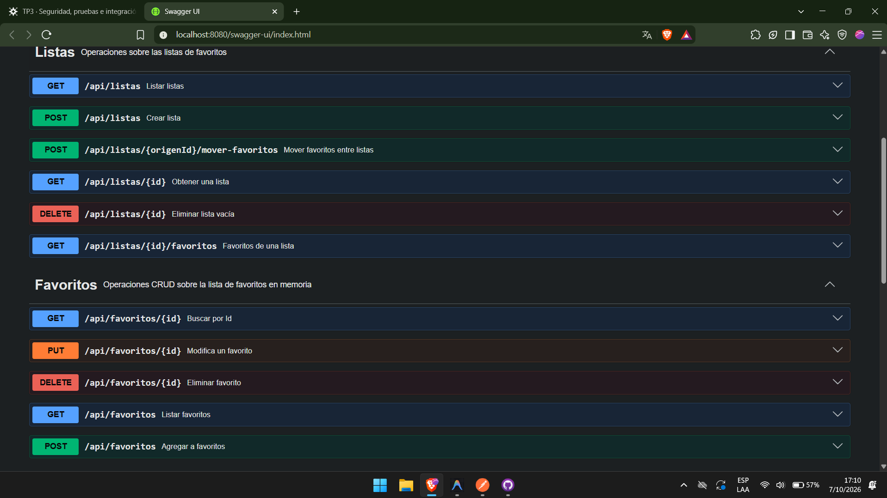

### Caso de Exito: Postman, al agregar una lista de favoritos
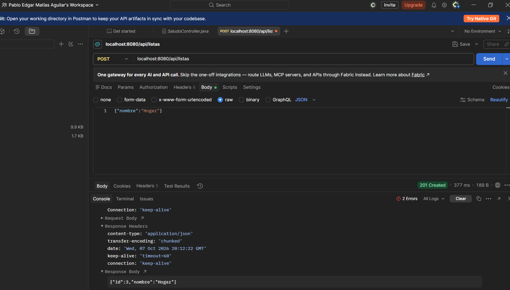

### Caso de Error: 409 Conflict al borrar lista con favoritos
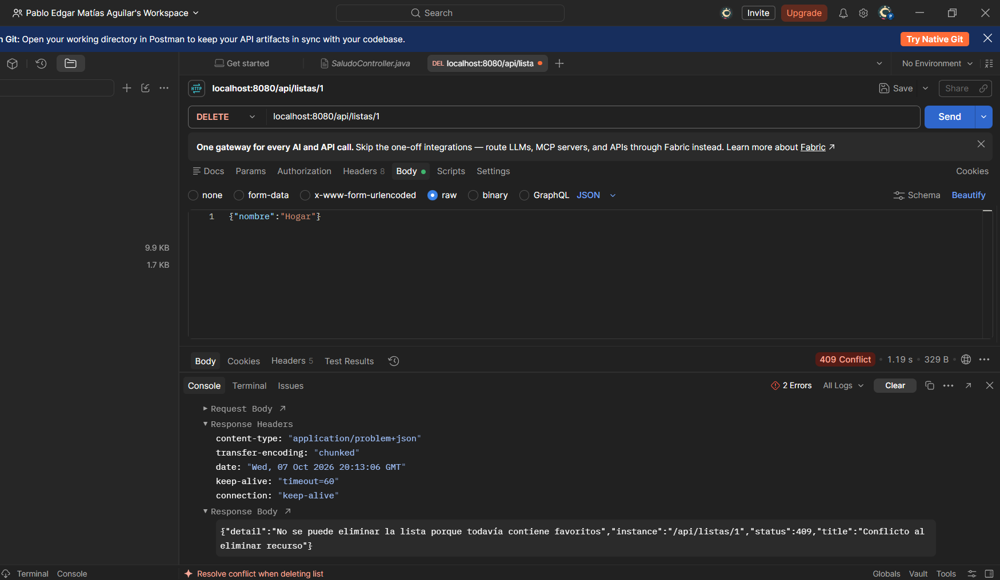

# TP3 · Seguridad, pruebas e integración continua

## 1. Registro y Persistencia de Usuarios (Paso 2)
Se implementó el registro de usuarios bajo el patrón de puertos y adaptadores:
- **Hashing seguro con BCrypt:** Las contraseñas nunca se persisten en texto plano. Se procesan mediante `PasswordEncoder` (`BCryptPasswordEncoder`) antes de almacenarse en la columna `password_hash`.
- **Rol por defecto:** Todo nuevo usuario registrado recibe automáticamente el rol `USER`.
- **Integridad y Conflictos (409 Conflict):** La columna `email` cuenta con restricción `UNIQUE` en PostgreSQL (migración `V5`). Si se intenta registrar un correo ya existente, `AuthService` lanza `EmailYaExisteException`, respondiendo un estado HTTP `409 Conflict`.
- **Seguridad en respuestas:** El DTO de salida `UsuarioResponse` omite deliberadamente cualquier referencia al hash de la contraseña.

### Evidencias de Registro y Persistencia

#### Registro exitoso de usuario (201 Created)
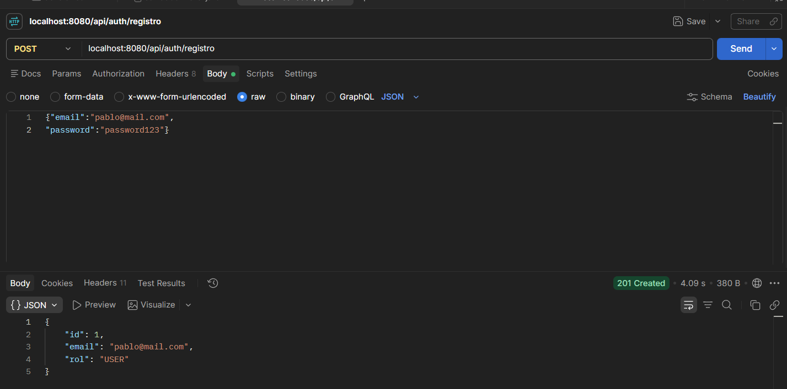

#### Manejo de error 409 Conflict (Email duplicado)
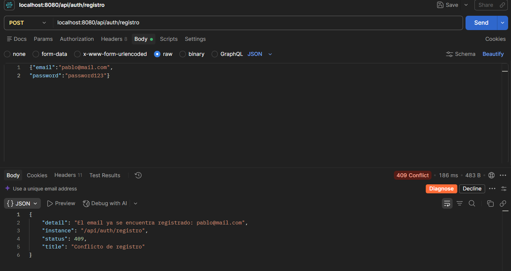

#### Persistencia en PostgreSQL con contraseñas hasheadas en BCrypt
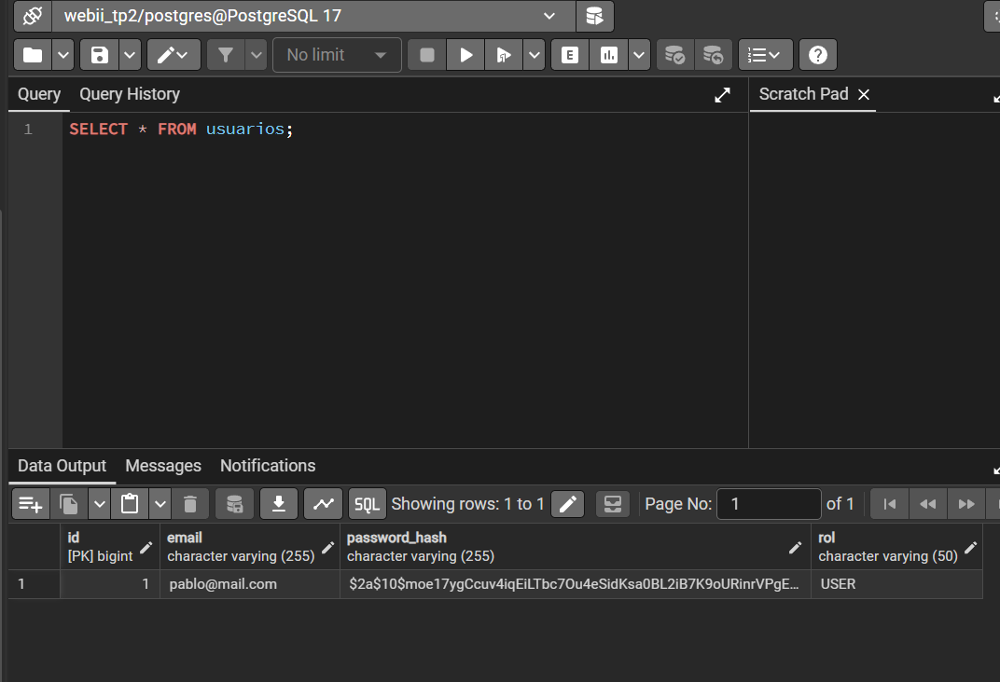

## 2. Autenticación y Emisión de JWT (Paso 3)

Se implementó el inicio de sesión y la emisión de tokens bajo el estándar JSON Web Token (JWT):

### Endpoint de Inicio de Sesión (`POST /api/auth/login`)
- **Validación segura de credenciales:** Se busca el usuario por email y se comprueba la contraseña enviada contra el hash almacenado mediante `passwordEncoder.matches()`. 
- **Prevención de ataques de enumeración:** Ante un usuario inexistente o una contraseña incorrecta, el sistema responde siempre con el mismo mensaje genérico (*"Email o contraseña incorrectos"*) y un código HTTP `401 Unauthorized`, evitando revelar si un correo electrónico se encuentra registrado.
- **Emisión del token:** Si las credenciales son válidas, `JwtService` genera un token firmado criptográficamente con algoritmo **HMAC-SHA256 (HS256)** que incluye en su payload el identificador (`id`), el correo (`sub`) y el rol (`rol`) del usuario.

#### Demo de la emisión de token (el usuario es ficticio, no hay datos sensibles en riesgo)
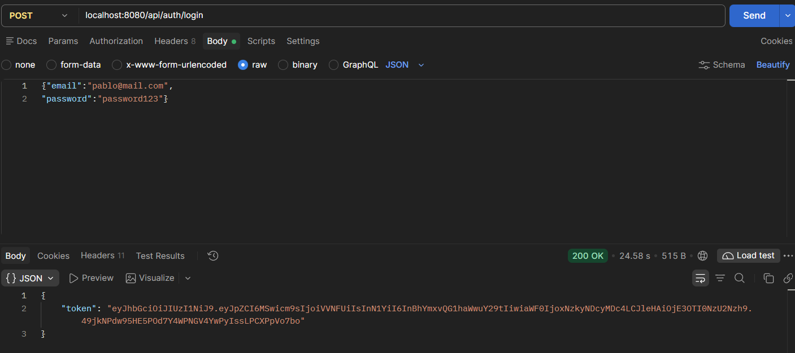

### Configuración de Seguridad Inicial (`SecurityConfig`)
- **Arquitectura Stateless:** Se deshabilitan las sesiones de servidor (`SessionCreationPolicy.STATELESS`) y la protección CSRF (`csrf.disable()`), ya que las peticiones se autentican de forma desacoplada mediante tokens y no por cookies de navegador.
- **Segmentación de rutas:** Se declaran públicas las rutas `/api/auth/**`, `/api/productos/**` y la documentación de Swagger (`/swagger-ui/**`, `/v3/api-docs/**`), exigiendo autenticación para cualquier otro recurso.

### Filtro de Autenticación JWT (`JwtAuthenticationFilter`)
- **Extensión de `OncePerRequestFilter`:** Garantiza que la validación del token se ejecute exactamente una vez por cada petición entrante.
- **Validación del encabezado `Authorization`:** Extrae el token con esquema `Bearer <token>`, valida su firma criptográfica y vigencia mediante `JwtService`.

#### Demo de la autorización por bearer token
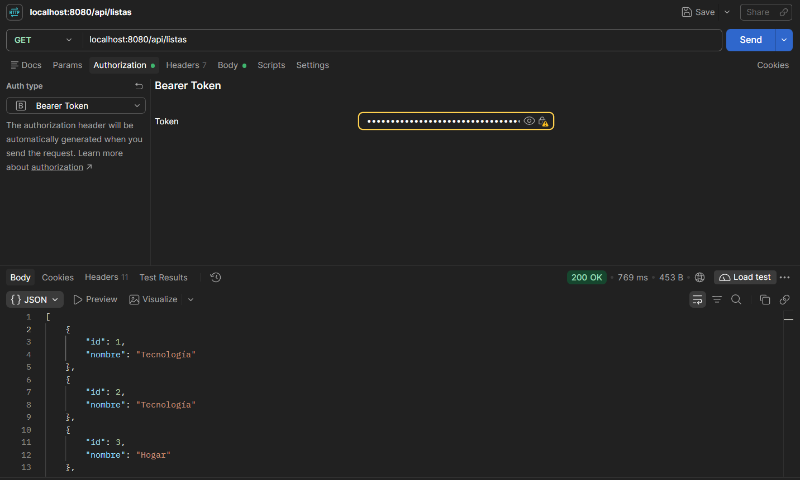

- **Inyección en el `SecurityContext`:** Establece una instancia de `UsernamePasswordAuthenticationToken` con los roles (`ROLE_USER` / `ROLE_ADMIN`) en el `SecurityContextHolder`, dejando la identidad disponible para las capas posteriores.
- **Protección efectiva:** Cualquier petición a endpoints protegidos (`/api/listas/**`, `/api/favoritos/**`) sin token o con uno inválido es rechazada automáticamente con un código HTTP `401 Unauthorized`.

#### Demo del código 401 al no estar autenticado
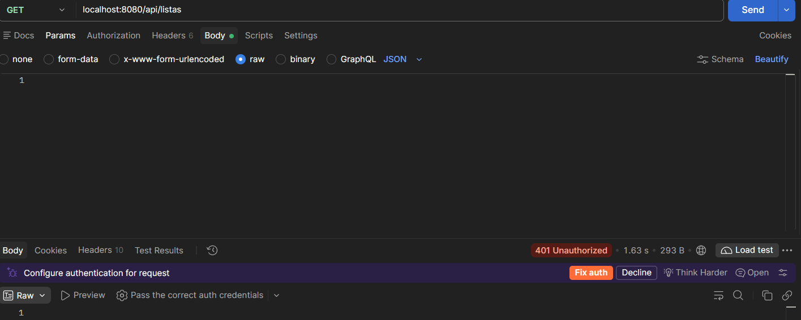

## 3. Autorización por Rol y Propiedad de Recursos (Paso 4)

Se implementó el control de acceso basado en roles (**RBAC**) y la propiedad de recursos sobre las listas de favoritos:

### 1. Modelado de Propiedad y Migración (`V6__add_usuario_id_a_listas.sql`)
- Se vinculó `ListaEntity` con `UsuarioEntity` mediante una relación muchos a uno en la columna `usuario_id` con clave foránea en PostgreSQL. Osea cada lista, tiene un usuario al cual hacer referencia.
- Se aplicó una migración evolutiva con backfill: se creó un usuario administrador inicial por defecto y se asignaron las listas históricas huérfanas antes de establecer la restricción `NOT NULL`.
- En el dominio puro, el record inmutable `Lista` incorpora el campo `Long usuarioId`, manteniéndose desacoplado de las anotaciones de Hibernate.

### 2. Reglas de Negocio en `ListaService` (Arquitectura Hexagonal)
- **¿Por qué la autorización se ubica en el Service y no en el Controller?** 
  En Arquitectura Hexagonal, las reglas de permisos y propiedad de datos son **reglas de negocio**. Ubicarlas en el `ListaService` garantiza que se apliquen siempre, sin importar si la llamada proviene de un controlador REST, de una prueba unitaria o de un proceso por lotes.
- **Creación segura (`POST /api/listas`):** El dueño de la lista se obtiene directamente del usuario autenticado en el `SecurityContextHolder`. El cliente no puede forzar la propiedad en el cuerpo de la petición.
- **Visibilidad segmentada (`GET /api/listas`):**
  - Si el usuario posee rol `USER`, la consulta se delega a `listaRepository.buscarPorUsuarioId(id)`, retornando únicamente sus listas.
  - Si el usuario posee rol `ADMIN`, puede auditar y visualizar todas las listas del sistema.
- **Protección de recursos ajenos (403 Forbidden):**
  - Cualquier intento por parte de un `USER` de consultar, modificar o eliminar una lista de otro usuario dispara `AccesoDenegadoException`, respondiendo un estado HTTP `403 Forbidden` bajo el estándar RFC 7807 (`ProblemDetail`).

### Evidencias de Autorización y Propiedad

#### Visibilidad restringida para usuario común (solo ve sus listas)
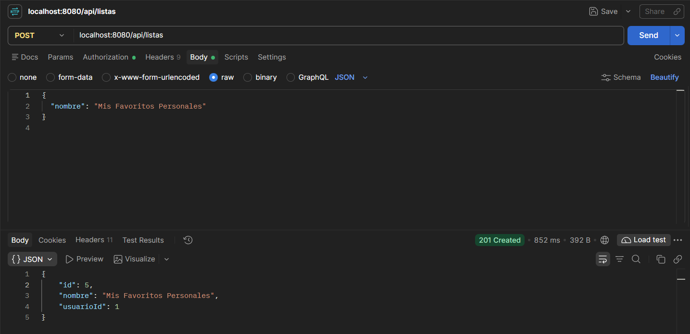

#### Visibilidad global para usuario administrador (ve todas las listas)
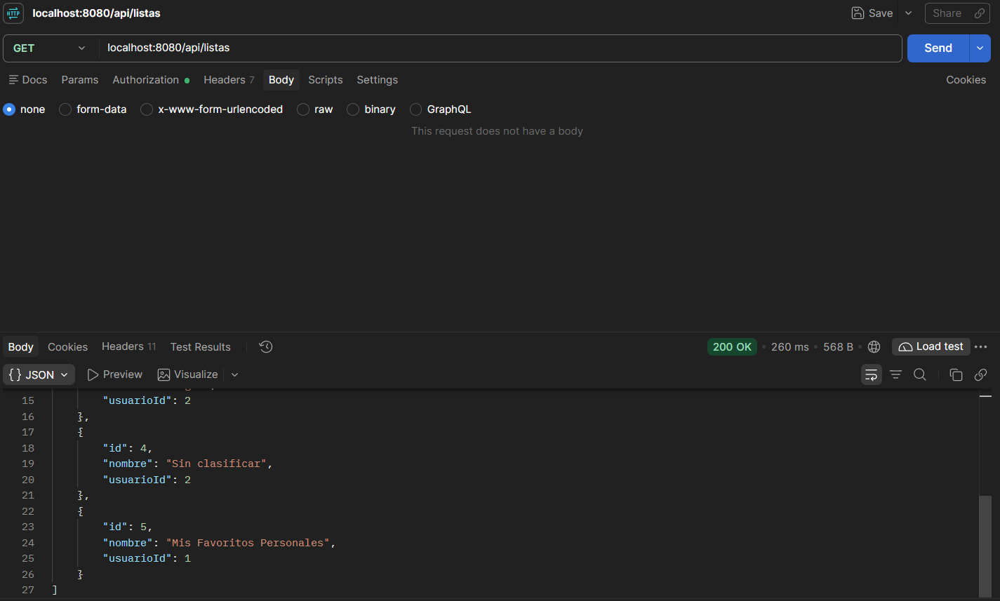

#### Control de acceso: 403 Forbidden al intentar acceder a una lista ajena
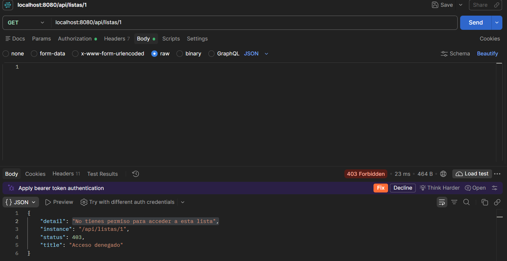

## 4. Pruebas Automatizadas (Paso 5)

Se diseñó una suite de pruebas automatizadas dividida en pruebas unitarias de negocio y pruebas de integración sobre bases de datos reales:

### 1. Pruebas Unitarias (JUnit 5 + Mockito)
Aíslan completamente la capa de aplicación y prueban la lógica pura sin levantar Spring ni tocar la base de datos:
- **`AuthServiceTest`:**
  - Garantiza que las contraseñas **NUNCA se persistan en texto plano**, verificando la invocación obligatoria a `passwordEncoder.encode()`.
  - Comprueba la prevención de correos duplicados (`EmailYaExisteException`).
  - Valida el rechazo con `401` ante contraseñas incorrectas y la emisión de tokens ante credenciales legítimas.
- **`ListaServiceTest`:**
  - Valida la **asignación automática de dueño** (`usuarioId`) leyendo el `SecurityContextHolder`.
  - Verifica el control de acceso: los usuarios comunes reciben `AccesoDenegadoException` (`403`) al intentar acceder o borrar listas de otros.
  - Verifica que los usuarios con rol `ADMIN` posean autorización global.
  - Comprueba la regla de integridad de negocio bloqueando el borrado de listas con favoritos (`409 Conflict`).

#### Evidencia de ejecución unitaria (100% de tests en verde)
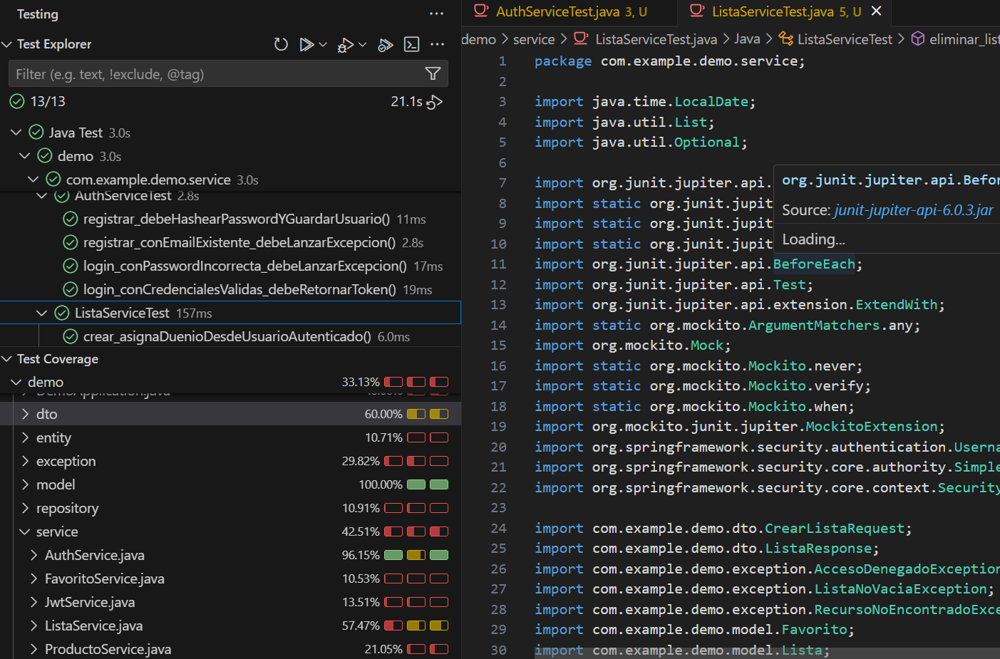

### 2. Pruebas de Integración con Testcontainers (PostgreSQL 17 en Docker)
Para evitar los falsos positivos de bases en memoria (como H2), se implementaron pruebas de integración reales utilizando **Testcontainers**:
- **Aislamiento absoluto:** Se levanta un contenedor Docker temporal con la imagen oficial de `postgres:17-alpine`.
- **Evolución del esquema:** Flyway ejecuta de forma limpia todas las migraciones (`V1` a `V6`) en cada corrida.
- **Autoconfiguración dinámica:** Con `@ServiceConnection`, Spring Boot inyecta automáticamente la URL, puerto aleatorio y credenciales generadas por el contenedor.
- **Escenarios de prueba integrales (`ApiIntegrationTest`):**
  1. `401 Unauthorized`: Rechazo automático ante peticiones a rutas protegidas sin encabezado `Authorization`.
  2. `401 Unauthorized`: Rechazo ante intentos de inicio de sesión con contraseñas inválidas.
  3. `201 Created`: Creación efectiva de una lista asignando el `usuarioId` del token en la base de datos PostgreSQL real.
  4. `403 Forbidden`: Bloqueo y respuesta `ProblemDetail` cuando un usuario con rol `USER` intenta acceder a una lista ajena.
  5. `200 OK`: Autorización irrestricta cuando un usuario con rol `ADMIN` accede a la lista.

#### Evidencias de Ejecución con Testcontainers

##### Contenedores efímeros instanciados en Docker Desktop
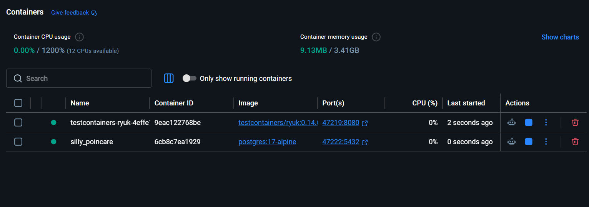

##### 100% de Pruebas de Integración exitosas en consola
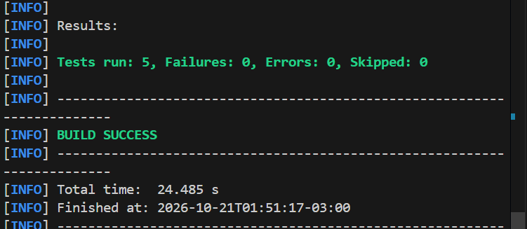

## 5. Integración Continua con GitHub Actions (Paso 6)

Se configuró un pipeline de Integración Continua (**CI**) mediante GitHub Actions en `.github/workflows/ci.yml`:
- **Disparadores (Triggers):** Se ejecuta automáticamente ante cualquier `push` o `pull_request` sobre las ramas `main` y `TP3`.
- **Entorno de ejecución:** Máquina virtual en la nube con `ubuntu-latest`, contenedor de servicio PostgreSQL 17 y JDK 25.
- **Orquestación en la nube:**
  1. Clona el repositorio y configura la versión de Java con caché de dependencias de Maven.
  2. El runner cuenta con Docker preinstalado, permitiendo que **Testcontainers** descargue y levante `postgres:17-alpine` de forma transparente durante el flujo de CI.
  3. Ejecuta `./mvnw clean test`, corriendo toda la batería de pruebas unitarias y de integración.
  4. Protege la calidad del código bloqueando cualquier fusión de cambios si una prueba no supera el 100% de éxito.

#### Evidencias de Ejecución en GitHub Actions

##### Pipeline ejecutándose en tiempo real en la nube
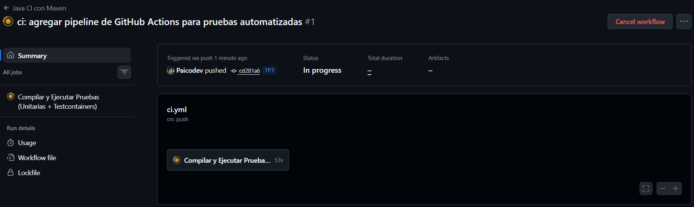

##### Pipeline finalizado con éxito (Build Passed ✅)
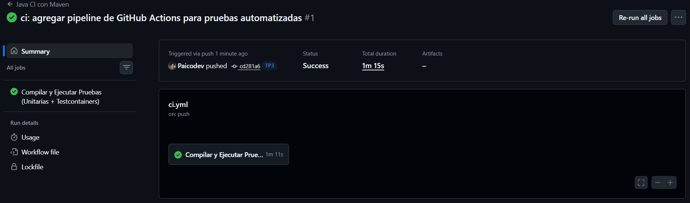

#### Validación de Detección de Errores (Fallo y Recuperación)
Se validó la efectividad del pipeline forzando una falla en una prueba unitaria:
1. **Detección del fallo:** Al introducir un error deliberado en la aserción de `AuthServiceTest`, el pipeline detuvo la construcción y marcó el commit en rojo (`Build Failed ❌`), impidiendo la integración de código defectuoso.
2. **Recuperación:** Al corregir la prueba y reintentar el push, el pipeline ejecutó nuevamente la suite completa, restableciendo el estado a verde (`Build Passed ✅`).
##### Pipeline fallando por error inducido en prueba unitaria
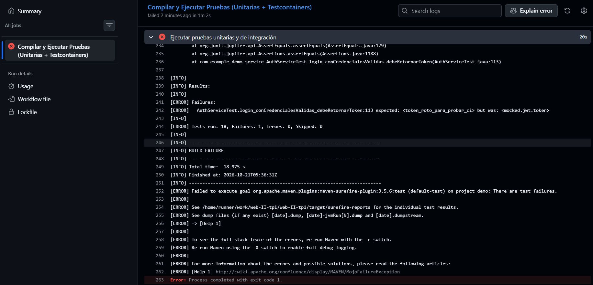

## 6. Despliegue en la Nube (Paso 7)

Se preparó la aplicación para ejecutarse de manera desacoplada en plataformas de tipo **PaaS** (como Koyeb) con base de datos PostgreSQL administrada y remota:

### 1. Preparación para Entornos de Producción
- **Contenedorización Multi-Stage (`Dockerfile`):**
  - **construcción (`build`):** Utiliza Maven sobre OpenJDK 25 para compilar y empaquetar el `.jar` aislando las dependencias.
  - **ejecución (`runtime`):** Imagen mínima con Eclipse Temurin JRE 25.
  - **Seguridad en contenedores:** Se ejecuta bajo un usuario sin privilegios (`spring:spring`), evitando correr la aplicación como `root`.
- **Puerto dinámico:** Se configuró `server.port=${PORT:8080}` en `application.properties` para escuchar en el puerto aleatorio asignado por el balanceador de carga de la nube.
- **Inyección segura de credenciales:** Ninguna contraseña ni clave secreta se almacena en el repositorio. Los valores se inyectan en tiempo de ejecución mediante variables de entorno:
  - `DB_URL`: Cadena de conexión JDBC hacia PostgreSQL remoto con cifrado SSL obligatorio.
  - `DB_USERNAME` y `DB_PASSWORD`: Credenciales de acceso a la base de datos remota.
  - `JWT_SECRET`: Clave de alta entropía (HMAC-SHA256) exclusiva de producción.

### 2. Base de Datos Remota y Despliegue en Render
- **Base de Datos:** Instancia gestionada de PostgreSQL 17 en la nube con soporte SSL.
- **Evolución del esquema:** Al iniciar en la nube, Flyway ejecuta de forma transparente todas las migraciones (`V1` a `V6`) en la base de datos remota.
- **URL pública de producción:** [https://web-ii-tp3.onrender.com](https://web-ii-tp3.onrender.com)


#### Evidencias de Despliegue en Producción

##### Servicio levantado y saludable en Render (Healthy / Running)
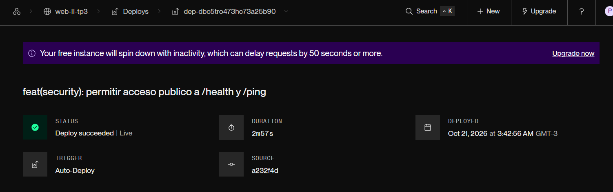

##### Petición en vivo hacia la nube desde Postman
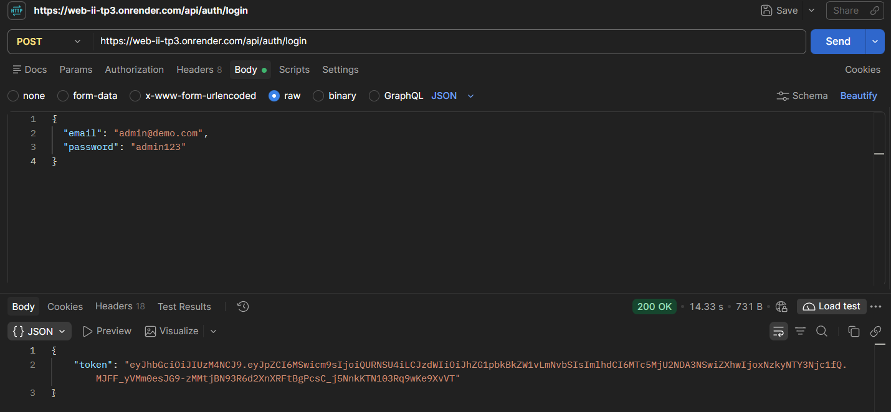

##### Servicio corriendo la ruta /health
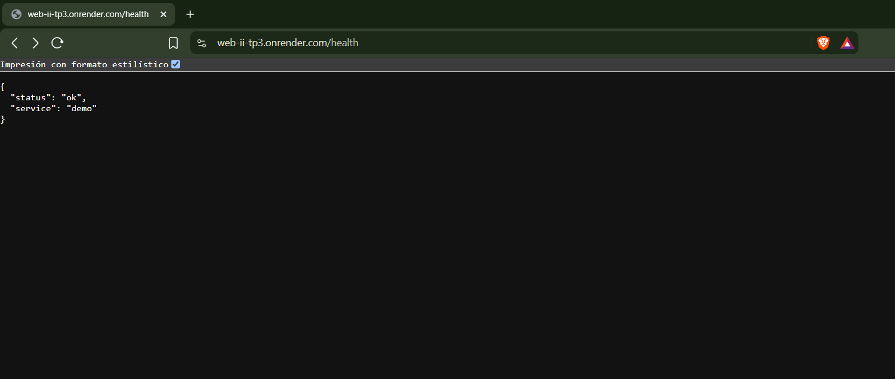
